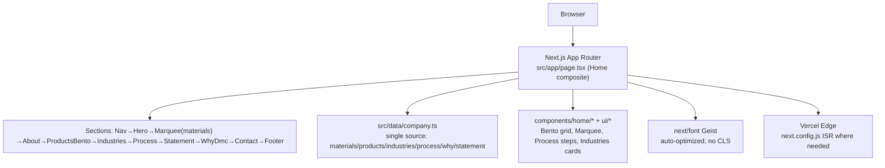

# Delhi Steel Website (DMC) — Architecture

> Premium Next.js 15 storefront for Delhi Metals Corporation (materials + products + industries + process). Tailwind, shadcn, marquee/bento, performance-first.

**Stack:** Next.js 15 (App Router) + TypeScript + Tailwind CSS + shadcn/ui + next/font(Geist) + Vercel deploy

---

## 1. Goals

- Hero-grade first paint: LCP <1.5 s on 3G, TTI <2 s
- Editor-friendly: content lives in `src/data/company.ts` not in JSX
- Industrial palette: `coal/line/neutral` tokens pulled from `~/.local/state/omarchy/current/theme` drift, not ad-hoc
- SEO: metadata + OG + JSON-LD (add)

## 2. High-Level



## 3. File Map

```
src/
├── app/
│   ├── layout.tsx (font, metadata, viewport)
│   ├── page.tsx (compose sections — ~10 lines, no logic)
│   └── globals.css (tokens)
├── components/
│   ├── Nav / Footer
│   └── home/ Hero, About, ProductsBento, Industries, Process, Statement, WhyDmc, Contact
│   └── ui/ Marquee, Button, Card
└── data/
    └── company.ts (company, materials[], products[], industries[], process[])
```

## 4. Design System

- Bento 3→1 col grid, coal bg `bg-coal/50`, border `border-y border-line`, pill accents for industry tags.
- Marquee continuous `py-6 sm:py-8`, `will-change-transform` + `requestAnimationFrame` not CSS `marquee`.
- Add blur+gradient hero overlay (screenpipe DESIGN.md discipline: flat first, shadows only for elevated surfaces).

## 5. Deployment & ENV

- `next.config.ts` untouched (no image domains yet) → add `remotePatterns` for CMS later.
- No email service is wired — the enquiry form opens a WhatsApp deep link client-side. `.env.local` holds only a Vercel OIDC token (gitignored).
- `npm run build` → Vercel (function fallback, no Docker needed).
- Next step (planned, not implemented yet): `next-sitemap` + `opengraph-image.tsx` + `app/api/contact` with zod + rate limit.

## 6. ADRs

**Next.js vs Astro:** Need App Router SSR for SEO but keep JSX composability. Astro is lighter but migration is ceremony for a marketing site already on Next.

**Tailwind vs CSS Modules:** Tailwind's `bg-coal/50` atomic tokens keep palette drift-free across 10 sections.
